<p align="center">
  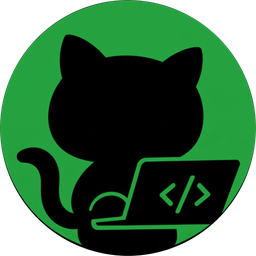
</p>

<h1 align="center">HandsOnRepo</h1>

<p align="center">
  Point it at any public GitHub organisation. It builds that organisation's company brain as a graph inside FalkorDB,
  then you ask it who owns what, who knows what, and why things were decided. Every answer shows its sources,
  the path through the graph that produced it, and the Cypher that ran.
</p>

<p align="center">
  Built for <b>Graph Hacks: Context for AI Agents</b>, a WeMakeDevs x FalkorDB hackathon, October 2026.<br/>
  Tracks entered: <b>Company Brain</b>, <b>Agents That Act on Connected Data</b>, <b>Agent Memory and Coordination</b>.
</p>

<p align="center">
  
  
  
  
  
  
</p>

<p align="center">
  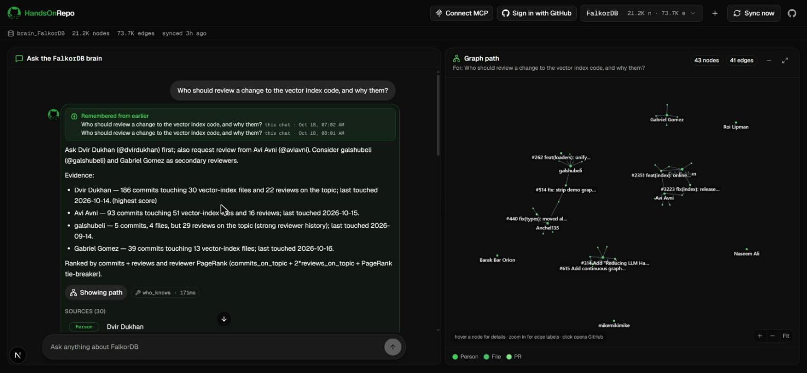
</p>

<p align="center"><sub>A real question against FalkorDB's own organisation. Left: the answer, its sources and the Cypher that ran. Right: the path through the graph. Graph time 171 ms; the rest is the language model.</sub></p>

---

## See it move

<table>
<tr>
<td width="50%">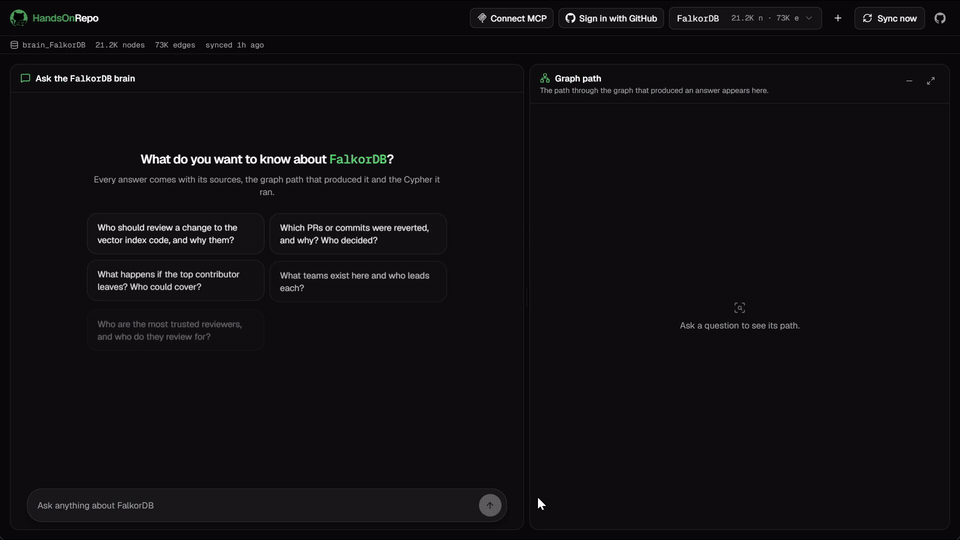<br><sub><b>Open an org.</b> Repositories, the most active people and who works where, before you type anything.</sub></td>
<td width="50%">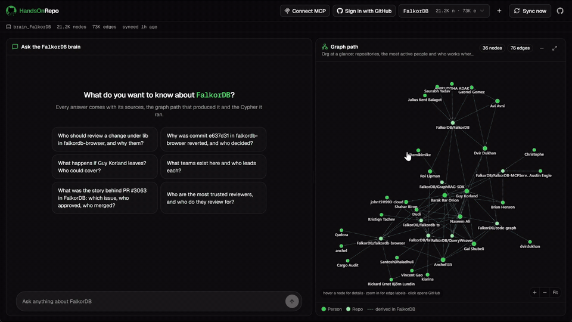<br><sub><b>Who should review this?</b> Ranked people with their commits and reviews, every source a GitHub link, the path drawn on the right.</sub></td>
</tr>
<tr>
<td width="50%">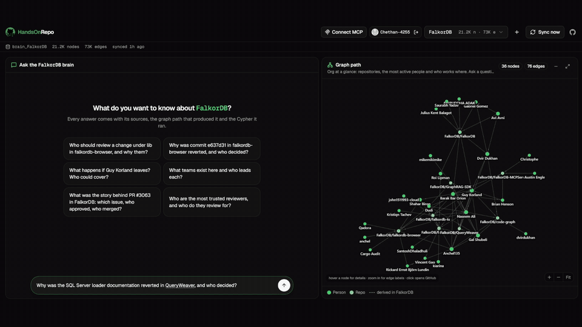<br><sub><b>Why was this reverted, and who decided?</b> Commit, revert, pull request, who merged it, and the Cypher that found it.</sub></td>
<td width="50%">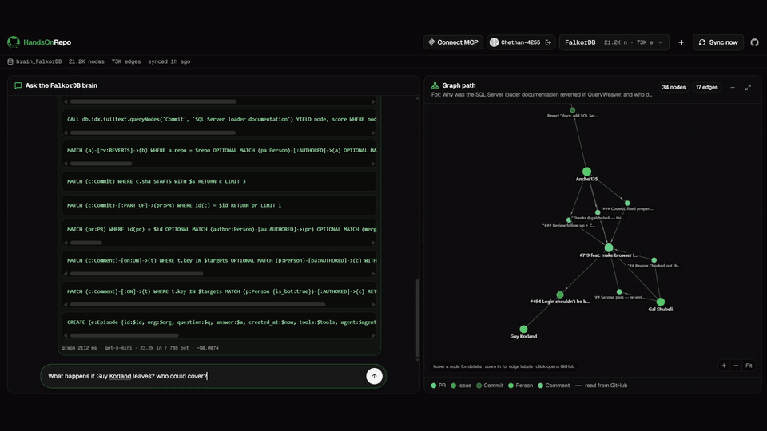<br><sub><b>What if this person leaves?</b> Files only they touched, open work, and who could cover each area.</sub></td>
</tr>
<tr>
<td width="50%">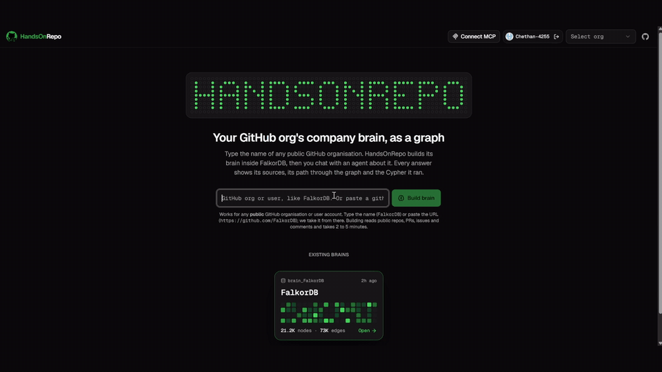<br><sub><b>Build a brain live.</b> Paste an org or a repository link; commits, PRs, reviews, issues and comments are read and folded into the graph while you watch the log.</sub></td>
<td width="50%">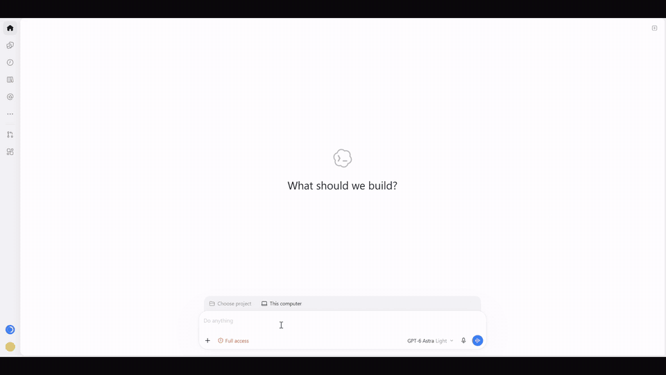<br><sub><b>The same brain in your coding agent.</b> Codex calls who_knows, reverts, decision_trail and remember over MCP, writes PR_NOTES.md, and the decision shows up in the web app as memory.</sub></td>
</tr>
</table>

## For the judges, in one minute

The brief says the graph has to do real work. Here is where each requirement lives, with the file to open.

| The brief asks for | What HandsOnRepo does | Where |
|---|---|---|
| Follow connections across data | Every answer is a multi-hop traversal or a graph algorithm over people, commits, PRs, issues, files, comments and releases | `backend/app/tools.py` |
| Remember across sessions | Every answer is stored as an `Episode` in FalkorDB and recalled before the next question. Survives restarts. Shown as "Remembered from earlier" | `agent.py`, `tools.recall` |
| Share state between agents | The chat agent, the triage agent and MCP clients read and write the same graph. The triage agent leaves `Action` nodes the chat agent can explain | `actions.py`, `mcp/server.py` |
| Connect people, projects and decisions | `MERGED`, `REVIEWED`, `CLOSES`, `REVERTS` and comment threads make a decision traceable from the issue that motivated it to the revert that undid it | `tools.decision_trail` |
| Show the path behind an answer | Sources, Cypher and the traversed subgraph come back with every answer and are drawn in the UI | `/api/ask` contract |
| Company Brain: docs, tickets, chats in one graph | README and docs chunks, issues and PRs, and 8,900 comment threads, all linked | `ingest.py` |
| Company Brain: who owns what, who knows what | `who_knows`, `top_reviewers`, owner Facts, `impact_of_leaving`, `teams` | `tools.py` |
| Company Brain: tracing decisions to their source | `decision_trail` and `reverts` | `tools.py` |
| Company Brain: keeping knowledge current | Webhook sync in seconds; changed owner facts get a `SUPERSEDES` edge instead of being overwritten | `sync.py`, `schema.refresh_owner_facts` |
| Agents That Act: algorithms as agent tools, MCP, explainable actions | PageRank, betweenness, label propagation and shortest paths are tools; the MCP server exposes all 18; the triage agent acts on issues with evidence | `tools.py`, `mcp/`, `actions.py` |
| Memory and Coordination: episodic and semantic memory, shared state, per-tenant memory | Episodes (episodic), owner Facts with history (semantic), Actions, one graph per organisation | `schema.py`, `tools.remember` |
| FalkorDB must be load-bearing | No cache, no fallback store. Remove FalkorDB and every feature fails. Argued query by query in the link | [`backend/queries/WHY_GRAPH.md`](backend/queries/WHY_GRAPH.md) |

## Verify it yourself

Because the demo brain is built on FalkorDB's own public organisation, every answer can be checked against GitHub.
Three to try:

1. **"Why was the SQL Server loader documentation reverted in QueryWeaver?"**
   The agent answers that the file belonged on the SQL Server branch and broke spellcheck on this one, reverted by
   Anchel135. Check the revert commit yourself:
   [819b96a](https://github.com/FalkorDB/QueryWeaver/commit/819b96a940d235a1a555f00795f1d282d6f01a82) reverting
   [6cc5a67](https://github.com/FalkorDB/QueryWeaver/commit/6cc5a6770378d94cde2baadf843b4d6a6d1d47ce), inside
   [PR #719](https://github.com/FalkorDB/QueryWeaver/pull/719).
2. **"Why was PR #43 in GraphRAG-SDK reverted, and who decided?"**
   The trail goes from [PR #43](https://github.com/FalkorDB/GraphRAG-SDK/pull/43) (merged by Gal Shubeli) to
   [PR #180](https://github.com/FalkorDB/GraphRAG-SDK/pull/180), the revert, nine days later by the same maintainer.
3. **"Which issue did the most recent merged PR in GraphRAG-SDK close?"**
   [PR #343](https://github.com/FalkorDB/GraphRAG-SDK/pull/343) closes
   [issue #342](https://github.com/FalkorDB/GraphRAG-SDK/issues/342), with the motivating text quoted from the issue.

Then ask something only you know the answer to. That is the point.

## By the numbers

Measured on the FalkorDB organisation, 8 repositories, on a laptop.

| | |
|---|---|
| Graph size | 21,181 nodes, 73,700 edges |
| Comment threads in the graph | 8,903 |
| Reviews, merges, reverts | 2,722 reviewed, 1,238 merged-by, 6 revert chains |
| Full ingestion | about 3 minutes, repositories fetched in parallel |
| Incremental sync | about 7 seconds |
| Graph time per tool call | 2 to 90 ms |
| Cost per answer | under half a cent with gpt-5-mini |
| GitHub API budget used for a whole org | under 100 of 5,000 hourly points |

---

## Why this exists

Every engineering organisation's knowledge is scattered across repositories, pull requests, reviews, issues and
comment threads. The questions people actually ask cannot be answered from any single document:

- Who really owns the vector index code, not who is listed, who touches it?
- Who should review this pull request?
- Why was that change reverted, and who decided?
- What happens if one specific person leaves tomorrow?
- What did we decide about this last week, and is it still true?

The answers live in the connections between people, code, decisions and time. A graph stores those connections
directly, so an agent can follow them in one query instead of guessing from text.

HandsOnRepo is deliberately built on real, public data. We demoed it on FalkorDB's own GitHub organisation, so the
judges can check any answer against reality. Nothing in this repository is a fictional company.

## What you can ask

These are live answers from the FalkorDB organisation's brain, each produced by one or two graph tool calls that
ran in under 100 milliseconds. The language model only phrases what the graph returns.

| Question | What the graph does |
|---|---|
| Who should review a change to the vector index code? | Finds the matching files, follows commit and review edges to people, ranks with PageRank over the reviewer graph |
| Why was the SQL Server loader documentation reverted in QueryWeaver? | Follows the REVERTS edge, reads the revert message and the comment threads, names who merged and who reverted |
| What happens if Guy Korland leaves? | Files only he has ever touched, directories he dominates, authors only he reviews, his open work, and who could cover each area |
| What teams exist and who leads each? | Groups people by the repositories they commit to and by label propagation over who touches the same files |
| Who are the most trusted reviewers? | PageRank over reviewer to author edges, humans only |
| What did I ask earlier? What did the triage agent do? | Reads the agent's own memory and action records from the same graph |

Ask a question in plain language. The agent picks the tool, the graph answers, and the UI draws the path.

## How it works

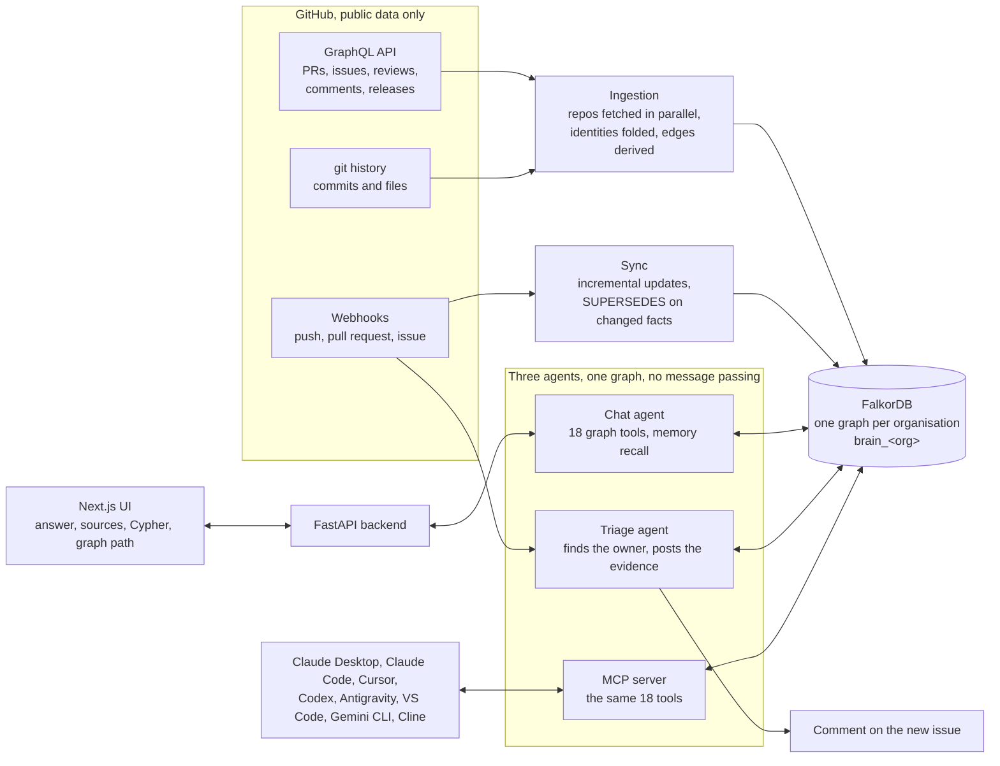

The chat agent, the triage agent and any MCP client read and write the same graph. A decision remembered from
Cursor shows up in the web app as "Remembered from earlier", and the chat agent can tell you what the triage agent
did and why, because the triage agent left an Action node behind.

<p align="center">
  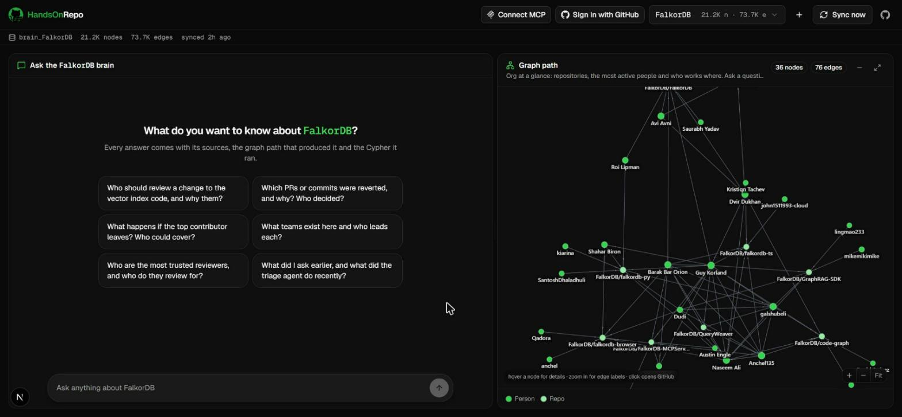
</p>

<p align="center"><sub>Open an organisation and the brain shows itself before you type: repositories, the most active people, who contributes where. Ask a question and this pane becomes that answer's path.</sub></p>

What happens when you ask a question:

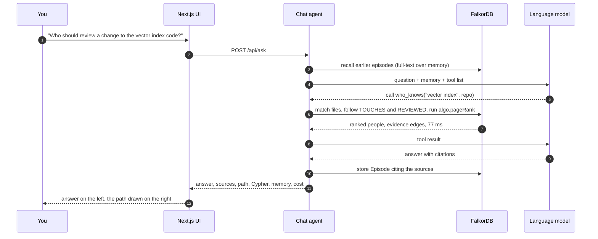

### Graph model

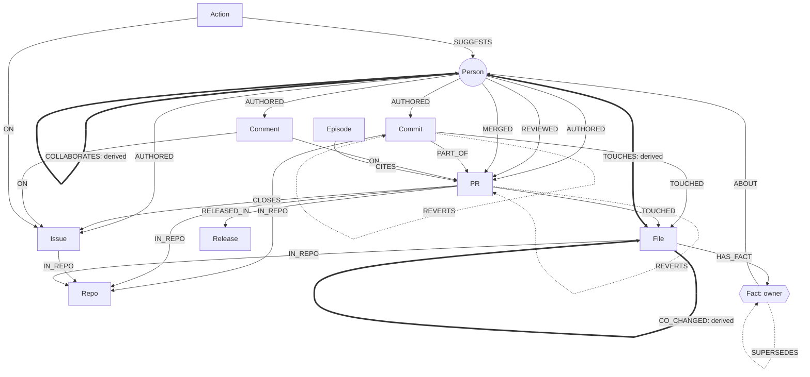

Thin arrows are read from GitHub, thick arrows are derived inside FalkorDB after ingestion, dotted arrows carry
history (a revert, a superseded fact).

Nodes

| Label | What it is | Key |
|---|---|---|
| `Person` | A GitHub user or git author | login (git-only authors are folded in by email, name or GitHub's noreply address) |
| `Repo` | A repository | owner/name |
| `PR` | A pull request, with state, labels, merge commit | owner/name#number |
| `Issue` | An issue | owner/name#number |
| `Commit` | A commit with message and date | sha |
| `File` | A file path inside a repo | owner/name:path |
| `Comment` | An issue comment, PR comment or review body | its GitHub URL |
| `Release` | A tagged release | owner/name@tag |
| `Doc` | A chunk of README or docs markdown | owner/name:path#chunk |
| `Fact` | A derived statement with history, today only ownership | subject + time |
| `Episode` | A question and answer the agent remembered | id |
| `Action` | Something an agent did, for example a triage comment | id |

Relationships read from GitHub

```
(Person)-[:AUTHORED]->(Commit | PR | Issue | Comment)
(Person)-[:REVIEWED {state, at}]->(PR)
(Person)-[:MERGED {at}]->(PR)
(Commit | PR)-[:TOUCHED {additions, deletions}]->(File)
(Commit)-[:PART_OF]->(PR)
(PR)-[:CLOSES]->(Issue)
(Commit)-[:REVERTS]->(Commit)     (PR)-[:REVERTS]->(PR)
(PR | Issue)-[:MENTIONS]->(Issue | PR)
(Comment)-[:ON]->(PR | Issue)
(Issue)-[:ASSIGNED_TO]->(Person)
(PR)-[:RELEASED_IN]->(Release)
(Doc)-[:DOCUMENTS]->(File)
(anything)-[:IN_REPO]->(Repo)
```

Relationships derived inside FalkorDB after ingestion

```
(Person)-[:TOUCHES {count, last}]->(File)          who has worked on what, aggregated from commits
(Person)-[:REVIEWED_FOR {count}]->(Person)         reviewer to author, the input to PageRank
(Person)-[:COLLABORATES {files}]->(Person)         people who touched the same files
(Person)-[:STRONG_COLLAB]->(Person)                the pruned version used for community detection
(File)-[:CO_CHANGED {count}]->(File)               files that change in the same commit
(File)-[:HAS_FACT]->(Fact)-[:ABOUT]->(Person)      current owner of a file
(Fact)-[:SUPERSEDES]->(Fact)                       the previous owner, so history is never lost
(Episode | Action)-[:CITES]->(anything)            what an agent's answer or action was based on
```

The FalkorDB organisation after ingestion: 21,181 nodes and 73,700 edges across 8 repositories, including 8,903
comment threads and 2,722 reviews. Ingestion takes about three minutes because repositories are fetched in parallel.

### The Cypher and algorithms the product depends on

Everything the agent runs is in [`backend/queries/`](backend/queries/), and every answer in the UI shows the exact
statements that produced it. [`backend/queries/WHY_GRAPH.md`](backend/queries/WHY_GRAPH.md) explains, question by
question, why a table or a vector store could not produce the same answer.

FalkorDB features in use:

- `algo.pageRank('Person', 'REVIEWED_FOR')` for reviewer trust
- `algo.betweenness` over `Person/COLLABORATES` for people who bridge groups, and over `File/CO_CHANGED` for critical files
- `algo.labelPropagation` over `STRONG_COLLAB` for inferred teams and over `CO_CHANGED` for code clusters
- `algo.SPpaths` with `relDirection: 'both'` for the path between any two things
- Full-text indexes on issues, pull requests, comments, commit messages, docs, file paths and the agent's memory
- Multigraph tenancy: one graph per organisation in a single instance, switched with `select_graph`
- `ro_query` for every read; the agent's free-form Cypher tool rejects writes before they reach the database

If FalkorDB is removed, nothing works. There is no cache and no fallback store; the graph is the product.

### The agent

The chat agent is an OpenAI tool-calling loop (default model `gpt-5-mini`, low reasoning effort) over 18 tools.
Each tool is a Python function that runs Cypher or a FalkorDB algorithm and returns the result together with its
sources, the statements it ran and the path it traversed.

| Tool | Answers |
|---|---|
| `who_knows` | ownership and expertise for a path, module or topic |
| `top_reviewers` | trusted reviewers and who they review for |
| `decision_trail` | the full story of a pull request in time order: issue, discussion, reviews, merge, release, revert |
| `reverts` | everything reverted, by whom, when and why |
| `impact_of_leaving` | the blast radius of one person leaving and who could cover |
| `teams` | product teams and collaboration clusters with leads |
| `bus_factor` | organisation-wide knowledge risk |
| `clusters` | code areas that change together |
| `owner_history` | current and past owners of a file |
| `recent` | latest PRs, issues, commits, releases, agent actions or memories |
| `node_context` | everything connected to one PR, issue, commit, person or file |
| `search` | full-text across the graph |
| `find_path` | how two things are connected |
| `recall`, `remember` | the agent's memory |
| `repo_overview`, `run_cypher` | the org at a glance, and read-only Cypher for anything else |

Before answering, the agent recalls earlier episodes that match the question and shows them as memory. For a question
about the organisation it always runs a fresh tool; memory is context, never a substitute. Greetings are answered
instantly without a model call.

A typical answer costs under half a cent and takes 5 to 12 seconds, nearly all of it in the language model. The
graph work is 2 to 90 milliseconds.

### Memory and coordination

- Every answer is stored as an `Episode` citing its sources. Memory survives restarts because it lives in FalkorDB.
- The triage agent records every action it takes as an `Action` node linked to the issue, the people it suggested
  and the evidence it used. Ask the chat agent what the triage agent did and it reads those nodes.
- MCP clients write into the same memory, so three agents coordinate through one graph per organisation.
- Owner facts carry `SUPERSEDES` history, so "is this still true?" has an answer and the old answer is kept.

## Run it locally

<p align="center">
  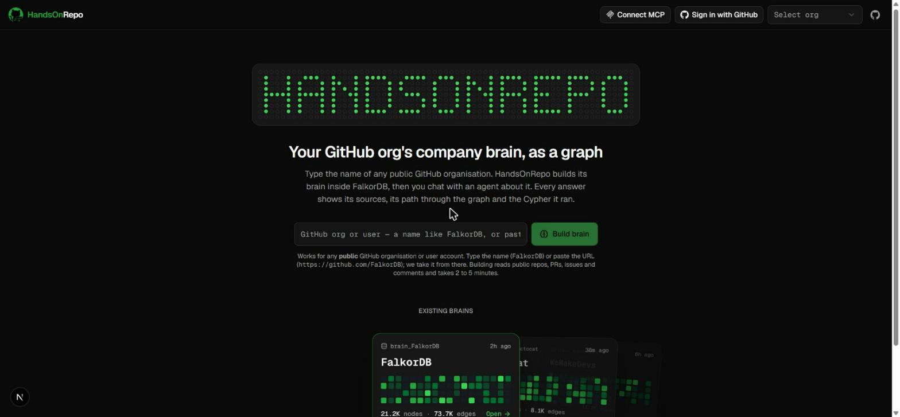
</p>

You need Docker, Python 3.12 or newer, Node 20 or newer, and two keys: a GitHub token (classic, `public_repo`
scope) and an OpenAI API key.

1. Start FalkorDB.

   ```bash
   docker run -d --name falkordb -p 6379:6379 -p 3000:3000 -v falkordb_data:/var/lib/falkordb/data falkordb/falkordb:latest
   ```

   FalkorDB Browser is now at http://localhost:3000 if you want to explore the graphs directly.

2. Backend.

   ```bash
   python -m venv .venv
   .venv/Scripts/pip install -r backend/requirements.txt mcp      # Windows
   # .venv/bin/pip install -r backend/requirements.txt mcp        # macOS / Linux
   cp backend/.env.example backend/.env
   ```

   Open `backend/.env` and fill in `GITHUB_TOKEN` and `OPENAI_API_KEY`. Everything else has working defaults.

   ```bash
   cd backend
   ../.venv/Scripts/python -m uvicorn app.main:app --reload --port 8000
   ```

   http://localhost:8000/health should report `falkordb: ok`.

3. Build a brain. Either from the UI (next step) or from the command line:

   ```bash
   cd backend
   ../.venv/Scripts/python -m app.ingest FalkorDB
   ```

   Repositories are fetched in parallel; a mid-sized organisation takes two to five minutes. Re-running is safe and
   fast, everything merges on stable keys and git clones are cached.

4. Frontend.

   ```bash
   cd frontend
   npm install
   echo BACKEND_URL=http://localhost:8000 > .env.local
   npm run dev -- -p 3001
   ```

   Open http://localhost:3001, type an organisation name or paste a github.com URL, and click Build brain.

### Environment variables

| Variable | Purpose |
|---|---|
| `FALKORDB_HOST`, `FALKORDB_PORT`, `FALKORDB_USERNAME`, `FALKORDB_PASSWORD`, `FALKORDB_SSL` | Database connection. Local Docker needs only host and port; FalkorDB Cloud needs all five. |
| `GITHUB_TOKEN` | Server-side GitHub token used for webhooks and for visitors who are not signed in. |
| `GITHUB_CLIENT_ID`, `GITHUB_CLIENT_SECRET`, `FRONTEND_URL`, `BACKEND_URL` | Sign in with GitHub. Register an OAuth App with callback `BACKEND_URL/auth/github/callback`. Signed-in users' tokens are used for their own requests. |
| `ACTION_REPO`, `GITHUB_WEBHOOK_SECRET` | The one repository the triage agent may comment on, and the webhook secret set on it. |
| `OPENAI_API_KEY`, `OPENAI_BASE_URL`, `LLM_MODEL`, `LLM_REASONING_EFFORT` | Any OpenAI-compatible endpoint with tool calling. |
| `MAX_REPOS`, `MAX_COMMITS_PER_REPO`, `MAX_PRS_PER_REPO`, `MAX_ISSUES_PER_REPO`, `FETCH_WORKERS` | Ingestion limits. Defaults keep an organisation under GitHub's hourly budget. |

### Live updates and the triage agent

Point a GitHub webhook on a repository you control at `BACKEND_URL/webhook/github` with the events push, pull
request and issues, and put its secret in `GITHUB_WEBHOOK_SECRET`. Pushes and pull requests update the graph within
seconds and owner facts that change get a `SUPERSEDES` edge. Set `ACTION_REPO` to that repository and, when an issue
is opened there, the triage agent finds the likely owner through the graph, posts a comment with the evidence, and
records what it did as an `Action` node.

## Use the brain from your own AI tools

HandsOnRepo ships an MCP server with the same 18 tools. Run this once and paste the output into your client's
config; it fills in the absolute paths for your checkout:

```bash
.venv/Scripts/python mcp/print_config.py             # JSON for Claude Desktop, Cursor, Windsurf, Antigravity, Gemini CLI, Cline
.venv/Scripts/python mcp/print_config.py vscode      # VS Code
.venv/Scripts/python mcp/print_config.py codex       # OpenAI Codex, TOML
.venv/Scripts/python mcp/print_config.py claude-code # the claude mcp add command
```

Project-level configs are already in the repository root (`.mcp.json`, `.cursor/`, `.vscode/`, `.agents/`,
`.codex/`), so opening the folder in Claude Code, Cursor, VS Code, Antigravity or Codex registers the server
automatically. The web app's Connect MCP button walks through every client. Full guide: [`mcp/README.md`](mcp/README.md).

<p align="center">
  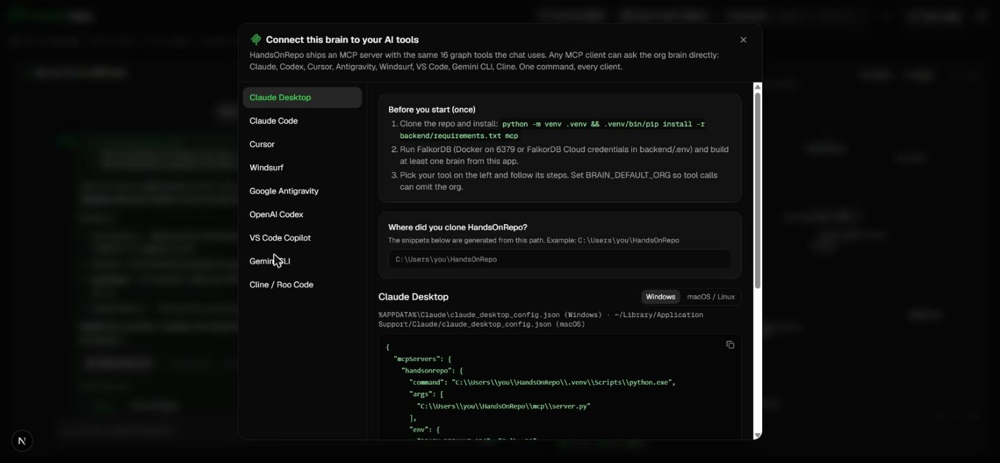
</p>

```bash
.venv/Scripts/python mcp/test_client.py              # launches the server over stdio and exercises the tools
```

## Project layout

```
backend/
  app/
    ingest.py        GitHub GraphQL + git history into the graph, parallel per repository
    schema.py        indexes, identity folding, derived edges, owner facts with SUPERSEDES
    tools.py         the 18 graph tools
    agent.py         the tool-calling loop, memory recall, greeting fast path
    sync.py          incremental sync and webhook handling
    actions.py       the triage agent
    auth.py          Sign in with GitHub
    main.py          FastAPI routes
  queries/           every Cypher statement and algorithm call, plus WHY_GRAPH.md
frontend/            Next.js 15 app: chat, sources, Cypher, graph path, org overview, Connect MCP
mcp/                 MCP server, client configs, config printer, smoke test
fixtures/            API response shapes for frontend work without a backend
```

## Data, limits and honesty

- Only public GitHub data is read. Nothing private, paywalled or personal goes into the graph.
- Bots (dependabot, copilot, coderabbit and friends) are flagged and excluded from rankings and trails.
- Git authors without a GitHub login are folded in where the evidence allows; the rest stay as names without
  handles and are never shown as mentions.
- When the graph has no evidence, the agent says so. It does not guess.
- GitHub's GraphQL budget is 5,000 points an hour; ingesting a whole organisation uses well under 100.

## Team

Built by **Mithuna Somireddy** and **Chethan Vasthaw Tippani** (team OrByte) for Graph Hacks: Context for AI Agents,
WeMakeDevs x FalkorDB, October 2026.

### Use of AI assistants

The core idea is ours: a company brain built from real public GitHub data, the graph model, the derived
relationships, the choice of algorithms and the way the agents behave. To move faster during the hackathon we used
Claude and Codex as coding assistants. We reviewed what they produced, we understand it, and we can explain every
query in `backend/queries/`.

## License

MIT. See [LICENSE](LICENSE).
